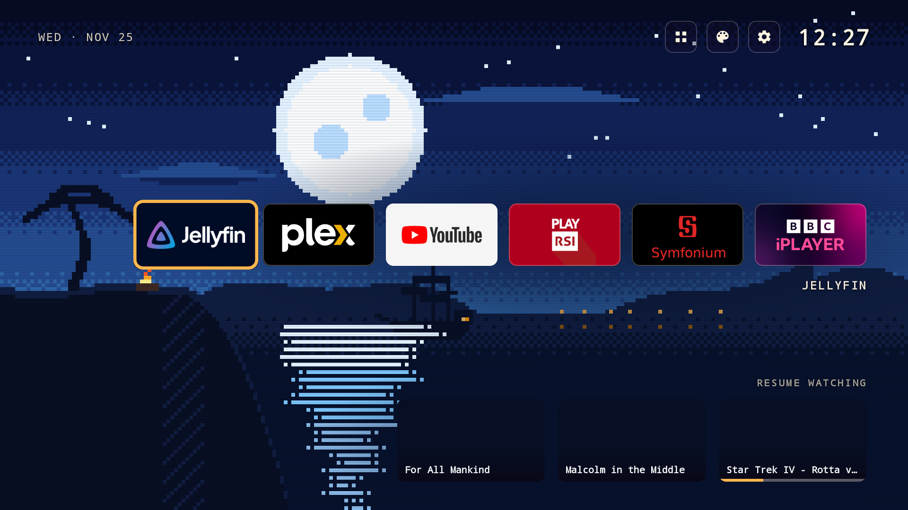
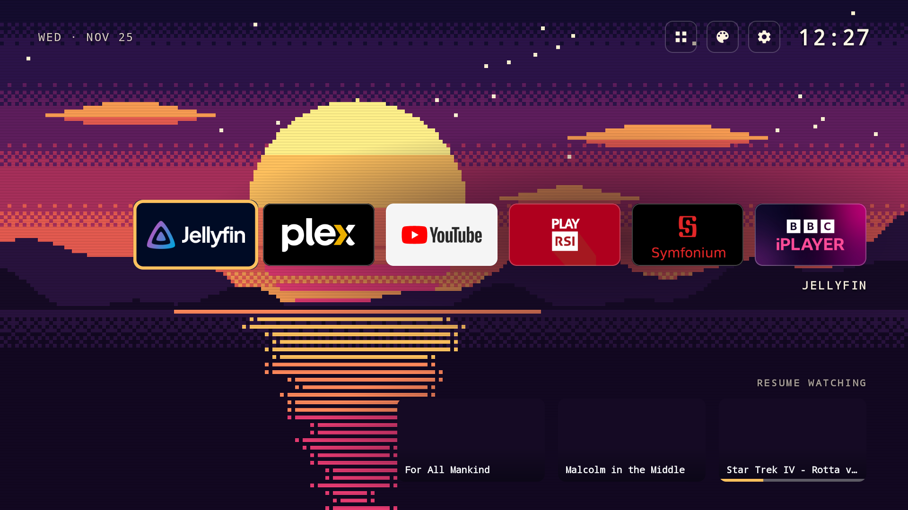
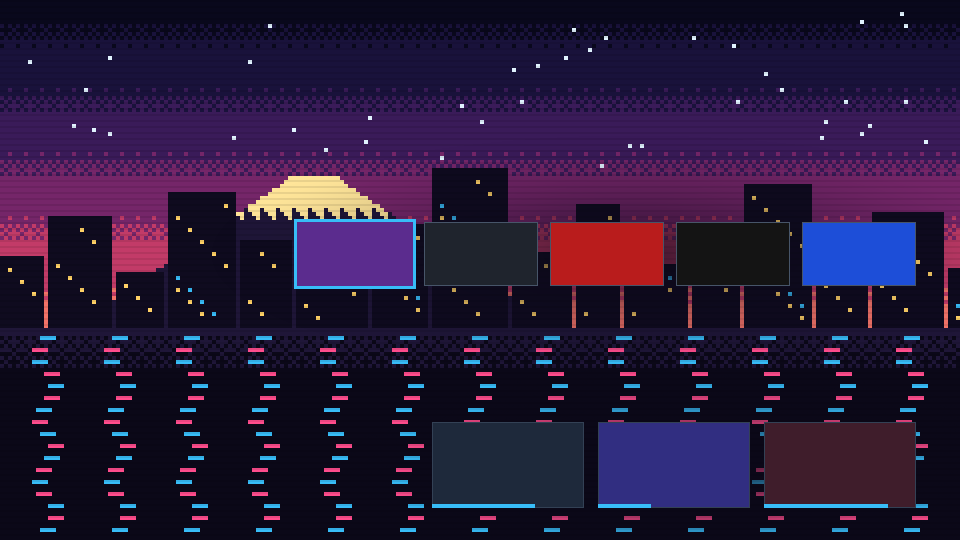
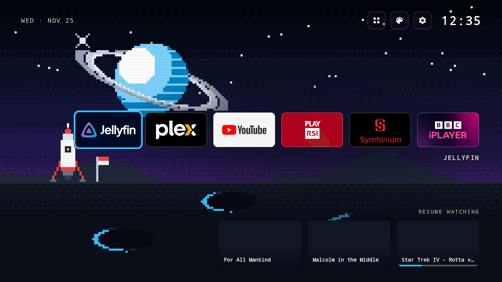

# Pixel Lounge

**An ultra-lightweight (~48 KB), ad-free Android TV / Google TV launcher with procedural 8-bit pixel-art backgrounds.**

Built with pure Android SDK (zero external dependencies, zero ads, zero telemetry) for instant startup and minimal RAM usage on devices like Chromecast with Google TV.

---

## Previews

### Monkey Island Night


### 8-Bit Digital Sunset


### Neo Tokyo 1988


### Space Age 1969


---

## Features

* **Zero Bloat & Zero Ads:** ~104 KB native APK with bundled authentic 8-bit retro typography (*Press Start 2P* and *Silkscreen*), no external dependencies, no recommendations, and no tracking.
* **Procedural 8-Bit Pixel-Art Engine:** Crisp nearest-neighbor `240×135` pixel canvas with ordered Bayer dithering, subtle toggleable CRT scanlines, and calm low-CPU animations (~4 FPS). Includes **9 curated themes**:
  * *Space Age 1969* — Ringed celestial orb, cratered lunar surface, Apollo retro rocket & orbiting beacon satellite
  * *8-Bit Digital Sunset* — Violet-to-gold twilight sky, striped retro sun, mountains & shimmering water
  * *Monkey Island Night* — LucasArts-inspired Lookout Point cliff, palm tree, flickering campfire, anchored pirate ship, giant moon & distant village lights
  * *Mêlée Island Sunset* — Lookout Point bathed in Caribbean twilight
  * *Neo Tokyo 1988* — Snow-capped Mount Fuji, lit pixel skyline & neon bay reflections
  * *Forest Fireflies* — Crescent moon, pine forest silhouettes & drifting fireflies
  * *Synthwave Dusk*, *Amber Arcade*, and *Pixel Lagoon*
* **Curated Right-Justified Layout:** Keeps the left half of the screen open for the pixel-art scene, with soft elliptical radial halos gently separating the trays from the background.
* **Native "Resume Watching" Bar:** Displays your 3 most recent Android TV *Watch Next* titles (with poster artwork, progress bars, and 1-click resume).
* **8-Bit Retro Side Drawers & Submenus:** Fast D-pad navigation with dedicated submenus for *Themes*, *Display & CRT*, *Layout & Dock*, and *Hidden Apps*.
* **Customizable Sizing:** Toggleable 3-stage *Font Size* (*Regular*, *Large*, *Small*) and *Icon Size* (*Compact*, *Tiny*, *Medium*).
* **Live Continuous Reorder Mode:** Smoothly slide favorite apps left/right across the row with instant visual feedback.
* **Full App Discovery:** Automatically discovers both native Leanback TV apps and sideloaded mobile apps.

---

## Remote Controls

| Action | Control |
| :--- | :--- |
| Launch app / Resume title | **Short-press OK** |
| Open App Options side drawer | **Hold OK** (or **Menu** key) on any app |
| Reorder Favorites | **Hold OK** → **Reorder Position** → **Left / Right** → **OK** to save |
| Browse All Apps / Pin / Hide | **Up** to Top Bar → **Grid icon** (or *Hold OK → All Apps Drawer*) |
| Switch 8-bit Themes & Toggles | **Up** to Top Bar → **Palette icon** |
| Close any side drawer | **Left** or **Back** |

---

## Project Structure

```text
pixel-lounge/
├── AndroidManifest.xml
├── build.sh                                  # One-command build, sign & ADB install script
├── docs/screenshots/                         # Live Android TV preview screenshots
├── res/
│   ├── drawable/                             # Vector banner & UI icons
│   └── values/styles.xml
└── src/com/essential/tvlauncher/
    ├── MainActivity.java                     # Home UI, side drawers, focus trapping, reorder mode
    ├── RetroSunsetView.java                  # Multi-scene procedural 8-bit pixel-art renderer
    ├── ThemeCatalog.java                     # 8 curated retro color palettes & scene configs
    ├── WatchNextLoader.java                  # Android TV Watch Next content provider + async artwork loader
    ├── AppLoader.java                        # Leanback + sideloaded app discovery
    ├── AppInfo.java                          # App metadata model
    └── PrefsManager.java                     # SharedPreferences persistence
```

---

## Building & Installing

### Prerequisites
* **JDK 17+** (`javac`, `keytool`)
* **Android SDK** (`platforms;android-34` and `build-tools;34.0.0`) at `ANDROID_HOME` (defaults to `~/.local/share/android-sdk`)
* **ADB** (`android-tools`) with Wireless Debugging enabled on your Android TV / Google TV

### 1. Build the APK
```bash
./build.sh
```
Outputs a signed APK at `build/essential-launcher.apk`.

### 2. Install on Android TV via ADB
```bash
# Connect to your Android TV (pair first if using Android 11+ Wireless Debugging)
adb connect <TV_IP>:<PORT>

# Build & install in one step
./build.sh --install <TV_IP>:<PORT>

# Grant Watch Next permission so the "Resume Watching" bar can read your titles
adb -s <TV_IP>:<PORT> shell pm grant com.essential.tvlauncher android.permission.READ_TV_LISTINGS

# Launch Pixel Lounge
adb -s <TV_IP>:<PORT> shell am start -n com.essential.tvlauncher/.MainActivity
```

### 3. (Optional) Set as Default Home Launcher on Google TV
Once you've tested Pixel Lounge and want pressing the **Home** button to open it permanently:

```bash
adb -s <TV_IP>:<PORT> shell pm disable-user --user 0 com.google.android.apps.tv.launcherx
adb -s <TV_IP>:<PORT> shell pm disable-user --user 0 com.google.android.tungsten.setupwraith
```

To revert to the stock Google TV launcher at any time:
```bash
adb -s <TV_IP>:<PORT> shell pm enable com.google.android.apps.tv.launcherx
adb -s <TV_IP>:<PORT> shell pm enable com.google.android.tungsten.setupwraith
```

---

## License

MIT — see [LICENSE](LICENSE).
